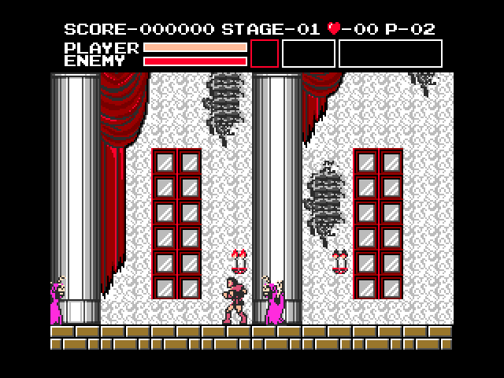

# VAMPIRE KILLER MSX PLUS — IPS生成ツール

[日本語](README.md) | [English](README.en.md)

MSX2用『悪魔城ドラキュラ／Vampire Killer』の**手元の原ROMから、選んだ修正のIPSを1枚生成するツール**です。公開物はツール、修正ソース、説明と検証記録です。生成済みIPS、原ROM、適用済みROMは含めません。

[生成ツール一式をダウンロード](dist/VAMPIREKILLER_MSX_PLUS_generator.zip)

## 使い方

ZIPを展開し、Python 3.10以降（画面版はTcl/Tkを含む）で起動します。追加のパッケージは不要です。

```powershell
python tools/patch_selector.py --lang ja
```

Windowsでは [select_patches.pyw](select_patches.pyw) のダブルクリックでも起動できます。無改変の原ROMを指定し、修正を選び、「IPSを生成」で保存先を選んでください。生成したIPSは無改変ROMのコピーへ1つだけ適用します。処理はこのPC内で行い、原ROMの送信や書き換えはしません。

項目名と要約へマウスを重ねると、**バグ説明・発生する場面・修正後の動作・補足**をtipsに表示します。「詳細」またはチェックボックスにフォーカスしてF1を押すと、全文をスクロールして読めます。日本語・英語を切り替えると説明も切り替わります。項目一覧もスクロールできます。

選択内容はJSONで保存・読込できます。IDで保存するため、項目が増えても以前の選択へ勝手に追加しません。

```powershell
python tools/patch_selector.py --list --lang ja
python tools/patch_selector.py path/to/original.rom --all --out build/all-fixes.ips --save-config build/my-selection.json
python tools/patch_selector.py path/to/original.rom --enable stairs hurt_clip shield_fix --out build/custom.ips
python tools/patch_selector.py path/to/original.rom --config build/my-selection.json --out build/rebuilt.ips
```

出力はIPSと `名前.ips.json` の生成記録です。記録には選択項目、元ROM・適用後ROM・IPSのSHA-256、変更範囲と容量を保存し、元データのバイト列は保存しません。再生成用の選択JSONは `--save-config` で別に保存します。既存ファイルの置換には画面での確認、またはCLIの `--force` が必要です。

## 対応する原ROMと容量

表示タイトルは本体（BIOS）のリージョンに応じて変わります。表示言語ではなく、**131,072バイト（1Mbit）**と次のSHA-256で原ROMを識別してください。

```text
99eabaaeb2b6c02220e131043d5a6401d0d8c5f413d89204547adcc04d65e7e2
```

新しいバグ修正を含む選択の適用後ROMは **2Mbit（256 KiB／262,144バイト）** です。元の画像・音楽・ステージ用バンクは元の位置のまま保ち、拡張領域へ修正コードを置きます。この構成では画像等の再圧縮・再配置を行いません。エミュレーターで指定が必要ならマッパーは **Konami／SCCなし** です。

従来の `fall_attack`・`screen_edges`・`shield_fix` だけを選ぶ場合は、従来と同じ1Mbit版を再現します。この互換構成のみ、原ROMから読み取った画像データをPC内で可逆圧縮・整理します。その結果のバイナリを配布物へ収録することはありません。

入力ROMのサイズとハッシュは生成前に照合します。IPS自体には元ROMの識別・競合検出機能がないため、生成したIPSを改変済みROMへ重ねて当てないでください。

## 選択できる修正

現在は26件の不具合への対応と画面端の挙動改善を収録しています。盾の2件を1項目にまとめているため、選択欄は26項目です。項目数は固定せず、修正ごとに追加できます。

| ID | 内容 |
|---|---|
| `fall_attack` | 落下中の武器使用 |
| `screen_edges` | 画面端の処理 |
| `shield_fix` | 盾の耐久修正 |
| `stairs` | 階段の終端を通り抜ける |
| `trap_contact` | 敵と鎖罠による二重被弾 |
| `trap_attack` | 罠に当たると攻撃が残る |
| `patrol_timer` | 歩行敵の方向転換期限を取り逃す |
| `mummy_start` | マミー出現直後の横移動 |
| `reform_hp` | 再形成する敵の耐久が一周する |
| `stun_hp` | 気絶する随伴敵の耐久が一周する |
| `hourglass` | ステージ移動後も時止めが続く |
| `actor_alloc` | 敵の生成失敗で描画枠が残る |
| `projectile_alloc` | 敵弾の生成失敗で描画枠が残る |
| `empty_projectile` | 空の投擲枠が命中する |
| `projectile_box` | 2本目だけ当たり判定が広がる |
| `crouch_fall` | 足場を失ってもしゃがんだまま浮く |
| `platform_land` | 移動床への着地位置が沈む |
| `platform_turn` | 折り返しで乗り手だけ進む |
| `shop_input` | 次の取引で最初の入力が消える |
| `boss_spawn` | ボス生成失敗で進行が止まる |
| `weapon_owner` | 古い投擲が新しい装備を消す |
| `axe_wall` | 別の投擲が当たると斧が壊れる |
| `hurt_clip` | 被弾時に壁や低い天井へ入る |
| `water_edge` | 聖水の消失で主武器を失う |
| `bat_y` | 天井コウモリの高さ判定 |
| `jumper_land` | のみ男が空中で着地する |

詳しい現象・発生条件はツールのtipsと「詳細」、または [項目一覧JSON](dist/catalog.json) にあります。斧と十字架が画面端で反転して戻る動きは維持します。

[examples/all-fixes.json](examples/all-fixes.json) は現在の全項目、[examples/selection.json](examples/selection.json) は従来3項目の選択例です。`--all` は実行時に登録されている全項目を選びます。

## 検証の範囲

新しい23項目は原版・各単独構成・全項目構成の25構成で、各4,517条件・4,814回の関数終了をopenMSX 21.0／C-BIOS MSX2 JPで確認しました。原ROMのコードへ入力RAM・レジスターを用意する関数・区間診断です。単独OFF時、共有する投擲メタデータ、2枠の判定、生成失敗時の予約、盾と時止めを同時に持つステージ移動などを含みます。[バグ修正の検証記録](dist/bug-verification.json)を参照してください。

全項目構成では、元のデータ用バンク98,304バイトがそのままであること、全168ポーズの位置・パターン・色、アイテム・燭台読み込み後のVRAM全128 KiBが原版と一致することを確認しました。別途、電源投入から通常キー入力だけで63.5秒動かして屋外3画面・城内3画面を通り、82回のサンプルで追加コードの保持を確認しています。[容量・画像・序盤操作の記録](dist/expanded-verification.json)に保存しています。

全項目構成の盾専用診断も、原版と各478条件・582回の関数終了を確認しました。[盾の検証記録](dist/expanded-shield-verification.json)を参照してください。

従来3項目から作る7構成は、これまでと同じIPS・ROMのハッシュを再現します。[互換ハッシュ記録](dist/manifest.json)、[従来の関数診断](dist/verification.json)、[従来の画像診断](dist/compact-verification.json)、[従来の盾診断](dist/shield-verification.json)を残しています。公開記録に元データのバイト列は含めません。

過去の全編通しプレイは、落下攻撃＋画面端だけを選んだ1Mbit構成が対象です。全19エリア・139画面、6体のボスと最終2形態、エンディング41項目、次周開始まで通過し、独立再生2回で全56,792更新が一致しました。[全編記録](dist/campaign-verification.json)と[ROMを含まない入力記録](dist/campaign-inputs.json.gz)を保存しています。

**新しい全項目構成の全編通しプレイと実機の動作は未確認です。** 関数診断と序盤操作の結果を、全編の動作確認とは区別してください。

## 再検証と修正追加

```powershell
python tools/verify_patch_files.py path/to/original.rom
python tools/verify_bugs.py path/to/original.rom --openmsx path/to/openmsx.exe
python tools/verify_expanded.py path/to/original.rom --openmsx path/to/openmsx.exe
python tools/verify_shield.py path/to/original.rom --openmsx path/to/openmsx.exe --all-fixes --out build/expanded-shield-verification
python tools/verify_selector.py path/to/original.rom
```

結果と診断用ROMは手元の `build/` へ保存します。画面環境がない場合、選択ツールの検証には `--skip-gui` を指定できます。その場合は記録にも未検証と残ります。

新しい修正の追加方法と、依存・競合・追加コード配置は [開発手順](docs/adding-fixes.md) に記載しています。従来7構成を手元で再生成する場合は `python tools/build_patches.py path/to/original.rom` を使えます。既定の出力先は `build/patches/` と `build/` です。

## 画面端の出現例



落下攻撃＋画面端だけを有効にした1Mbit構成を、電源投入から通常のキー入力で動かした未加工のopenMSXスクリーンショットです。
